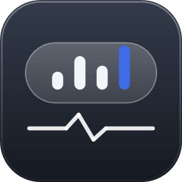

# DeskMon

一款常驻桌面的透明硬件监控条。显示 CPU / GPU 负载与温度、风扇转速、内存与显存占用、网络速率，样式接近 iOS 的胶囊小组件。



## 特性

- **桌面层模式**：固定后是一个普通顶层窗口，压在 Z 序底部并跟随桌面显示；不置顶、不进 `WorkerW`、不抢焦点，全屏游戏时不会盖在画面上。
- **点击穿透**：托盘菜单可切换 `WS_EX_TRANSPARENT`，开着也不会挡住桌面图标。
- **位置记忆**：拖动后按物理像素保存位置，显示器/缩放变化后自动钳位回工作区。
- **托盘控制**：显示/隐藏、锁定、点击穿透、开机自启、固定到桌面。
- **单实例**：Mutex 保护，重复启动只会唤醒已有窗口。
- **自检入口**：`DeskMon.exe --render-test out.png` 离屏渲染截图，`--metrics` 输出布局指标，`--dialog-test` 构建两个对话框后退出（验证 XAML 资源解析），便于无窗口验证界面。
- **游戏数字震动**：游戏进入前台时自动把 NVIDIA 数字震动切到设定值，切走或退出即还原；按进程名匹配，可从 vibranceGUI 导入旧配置。

## 游戏数字震动

托盘菜单 →「游戏数字震动…」里开关并维护游戏列表：

- 直接 P/Invoke 调用系统自带的 `nvapi64.dll`，**不依赖任何第三方 DLL**；取值范围 **0–100**（50 为中性），与 NVIDIA 控制面板一致。
- 用 `SetWinEventHook(EVENT_SYSTEM_FOREGROUND)` 监听前台切换，不是轮询，空闲几乎无开销。
- 按进程名匹配（不含 `.exe`），命中即切换、切走即还原，程序退出时同样还原，不会把颜色留在游戏值上。
- 「从 vibranceGUI 导入」读取 `%APPDATA%\vibranceGUI\applicationData.xml`，并把旧工具的 0–63 刻度换算为百分比。
- 非 NVIDIA 显卡、驱动缺失或接口不可用时，对话框会说明原因，监控条本身不受影响。

## 环境

- Windows 10 / 11
- .NET Framework 4.8（WPF）
- 传感器依赖 [LibreHardwareMonitor](https://github.com/LibreHardwareMonitor/LibreHardwareMonitor)：`LibreHardwareMonitorLib.dll`、`HidSharp.dll` 及其余依赖需放在仓库上一级的 `lib\` 目录（`..\lib\*.dll`）。部分温度/风扇传感器需要管理员权限才能读取。

## 构建

```
git clone <this repo> DeskMon
cd DeskMon
# 把 LibreHardwareMonitorLib.dll 等依赖放进 ..\lib\
msbuild app\DeskMon.csproj /p:Configuration=Release
```

输出在 `app\bin\Release\`。直接运行 `DeskMon.exe` 即可，设置保存在 exe 同目录的 `DeskMon.settings.json`。

## 日志

- `deskmon-position.log`：固定/位置调整过程，每进程上限 40 行
- `deskmon-ui.log`：界面与托盘事件

## 说明

本项目按当前使用环境实现，未做多语言与高对比度主题适配。两个对话框的样式集中在 `Theme.xaml`，共用同一套深色皮肤。传感器名称来自 LibreHardwareMonitor，不同主板的可用项会不同，缺失项会自动隐藏。
